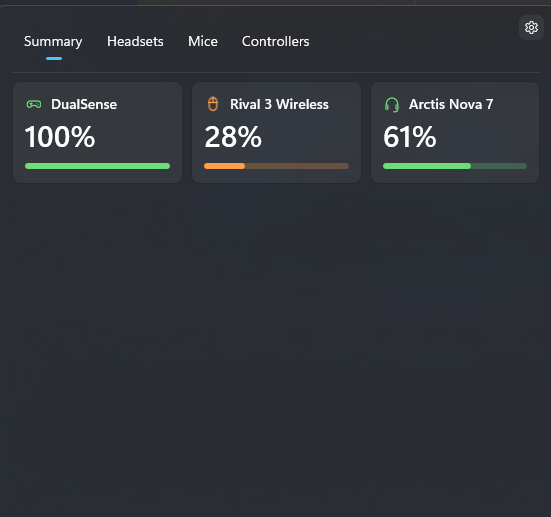
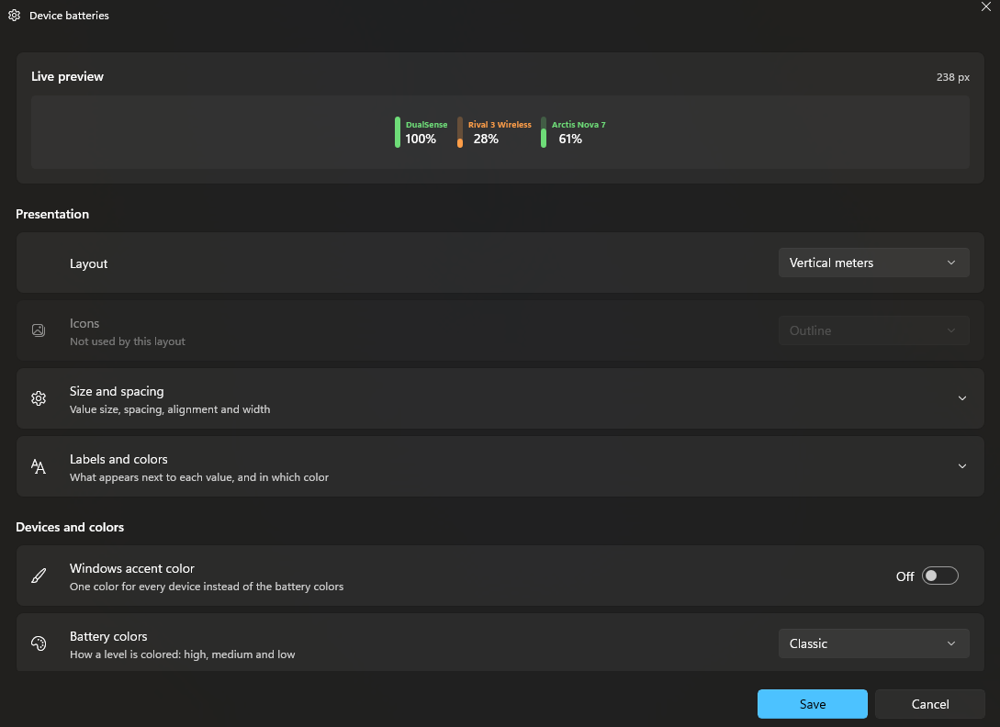

# Device batteries for WidBar

A widget for [WidBar](https://apps.microsoft.com/detail/9pkldnm83tp9) that puts the battery level of your wireless
headset, mouse and controller on the Windows taskbar. Click it for a flyout with the details.

I wrote it because none of the widgets I found for WidBar read peripheral batteries, and the vendor apps only show
them while their own window is open. It reads each device directly, nothing is sent anywhere, and there is no account
to create.

## What it shows

- One tile per device with its level, in a colour that follows the level. A bolt means the device is charging, and a
  "!" means it is at or below your low-battery level (20% unless you change it).
- A device that is asleep keeps its last known level, dimmed. The levels are remembered between runs, so a mouse that
  is off when you start the PC still has a value.
- A device that stays disconnected for 30 minutes leaves the taskbar and comes back when it reports again. You can
  change the time or turn it off. It stays in the settings list, so its name and colour are kept.
- When you switch between game controllers, the one you stopped using steps aside for the one that is connected now.
- A Windows notification when a device reaches the low-battery level. It shows once, and again only after the device
  has been charged.
- A flyout on click, with a summary and a tab for each kind of device, showing the level, a bar, the state and when it
  was last heard from. On a device's tab you also get its last 24 hours as a line, and an estimate of the time left
  once the readings are steady enough to trust. A week of readings is kept.

## Supported devices

| Device | Connection | How it is read | Tested on real hardware |
|---|---|---|---|
| SteelSeries Arctis Nova 7 (7P, 7X, Gen 2, Diablo IV, WoW) | USB dongle | SteelSeries HID status request | Yes (Nova 7) |
| SteelSeries Arctis Nova 5 and 5X | USB dongle | same | No |
| SteelSeries Arctis Nova 3P and 3X Wireless | USB dongle | same | No |
| SteelSeries Arctis 7+ (PlayStation, Xbox, Destiny) | USB dongle | same | No |
| SteelSeries Arctis GameBuds | USB dongle | same | No |
| SteelSeries Arctis Nova Pro Wireless and Pro Wireless X | USB base station | same, different request | No, and the reply layout is unconfirmed |
| SteelSeries Rival 3 Wireless | USB dongle | SteelSeries HID status request | Yes |
| Sony DualSense and DualSense Edge | USB cable, or Bluetooth if you turn it on | HID input report | DualSense yes (both), Edge no |
| Xbox controllers, and other pads that report through XInput | Xbox wireless adapter or USB | XInput | No |
| Bluetooth LE devices with the standard Battery Service | Bluetooth | Windows Bluetooth stack (GATT 0x180F) | No, not inside WidBar yet |

Some limits worth knowing before you install:

- **DualSense over Bluetooth is off until you turn it on** (Data refresh in the settings). Over Bluetooth the pad only
  sends its battery after it is asked for a report that switches it to its extended mode, and it stays in that mode
  until it reconnects. I could not test whether that changes how a game sees the pad, so it is your call. A pad on a
  cable is always read.
- **XInput only reports four coarse levels**, so an Xbox pad shows 5, 30, 65 or 100%. A wired Xbox pad has no battery
  and shows "USB".
- **A pad in XInput mode is called "Xbox Controller"** whatever it really is (some 8BitDo pads can run in this mode),
  and two such pads in the same slot share one entry. I have not tested any 8BitDo pad.
- **Wireless headsets need their USB dongle plugged in.** Over plain Bluetooth the SteelSeries models are not read.
- Logitech, Razer, HyperX, Corsair and Bluetooth classic devices are not supported. HyperX Cloud Jet in particular: I
  could not find a documented protocol for it, and I will not guess one.

The SteelSeries readers send only fixed, read-only status requests, and the DualSense reader never writes to the pad
(the Bluetooth request above is a read).
If your device is missing and you want it added, use **Request support for a device** under Help in the widget's
settings. It opens a GitHub issue with the list of devices Windows sees (vendor and product ids and names only, no
serial numbers) already filled in, and nothing is sent until you submit it. There is also a Copy report button.

## Install

You need Windows 11 and [WidBar](https://apps.microsoft.com/detail/9pkldnm83tp9) from the Microsoft Store.

The widget is not in the Store. Releases are signed with a self-signed certificate, so you trust it once:

1. Download the `.msixbundle` and the `.cer` from the [latest release](../../releases/latest).
2. Double-click the `.cer`, choose Install Certificate, Local Machine, and put it in **Trusted People**. This needs
   administrator rights.
3. Open the `.msixbundle` and install it.
4. In WidBar, add **Device batteries** to the taskbar.

If the installer complains about a missing `Microsoft.WindowsAppRuntime.2` dependency, install the Windows App SDK 2.x
runtime from https://aka.ms/windowsappsdk and try again. To update, install the newer bundle over the old one.

## Settings

Open the widget's settings from WidBar. The preview at the top follows every change, and options that the chosen
layout does not draw are greyed out.

- **Layout:** vertical meters, minimal text or minimal icons, with the value size, spacing, alignment and width.
- **Look:** labels, percent symbol, separators, charging bolt, coloured labels and values, the Windows accent colour,
  and the battery colours (classic, colour-blind, pastel, high contrast, mono or your own).
- **Devices:** which ones show, in what order, and a name and colour for each.
- **Behaviour:** the low-battery level and whether it sends a notification, how long a disconnected device stays on
  the taskbar, how often the batteries are read (every 1 to 10 minutes), and the DualSense Bluetooth switch.

## Privacy

Everything stays on your PC and nothing is sent over the network. The last known levels and a week of readings are
kept in the widget's shared data folder, so a sleeping device still has a value after a restart and the flyout has a
history to draw.

## Building it yourself

See [docs/development.md](docs/development.md) for building, testing, packaging and releasing.

## Credits and licence

The SteelSeries and DualSense readers are ported from [Gabrielfch/taskbar-battery-widget](https://github.com/Gabrielfch/taskbar-battery-widget),
and the DualSense status byte follows the Linux `hid-playstation` driver. Details are in
[THIRD_PARTY_NOTICES.md](THIRD_PARTY_NOTICES.md). The widget uses the
[WidBar widget SDK](https://github.com/andelby/widbar-widget-template).

MIT, see [LICENSE](LICENSE).
